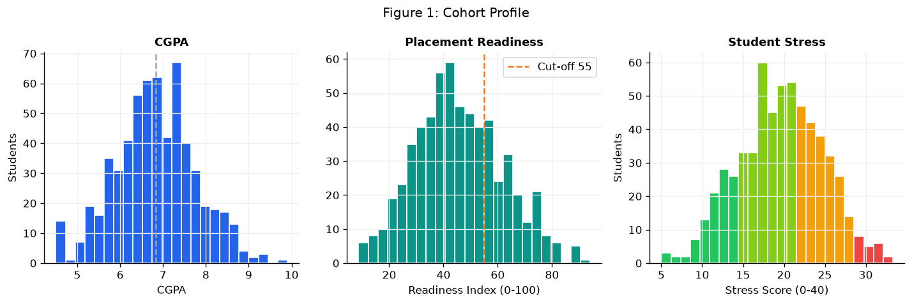
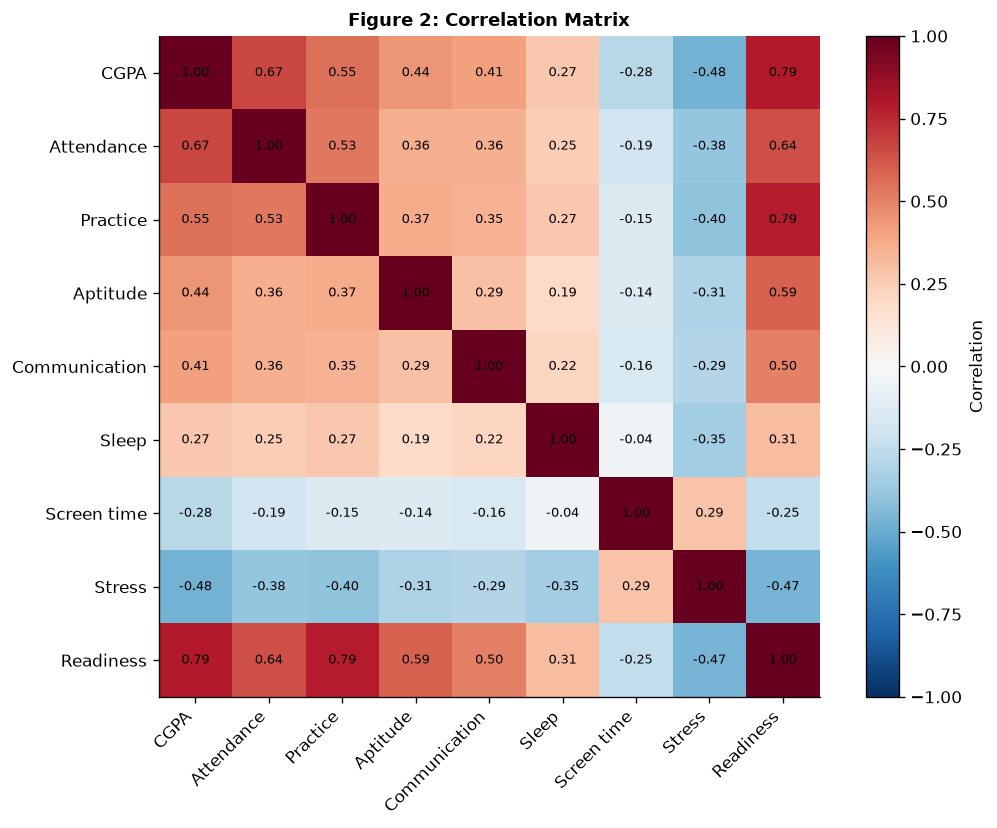
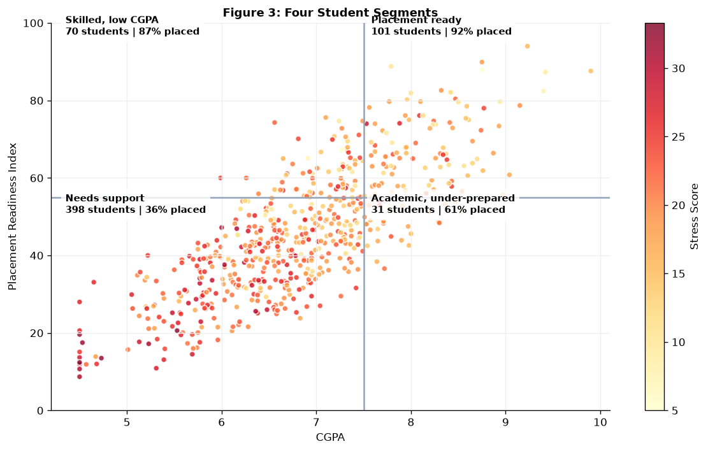
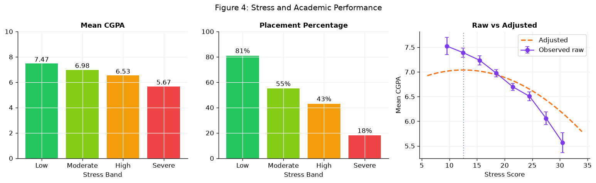
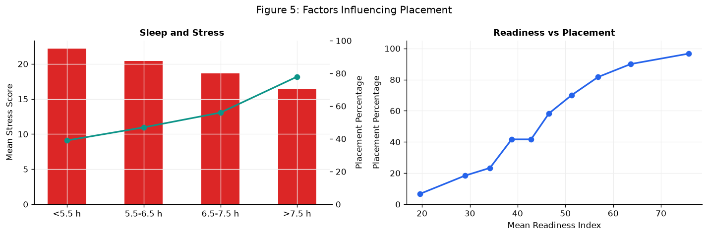

# Student-Readiness-Project
%pip install numpy pandas matplotlib
Requirement already satisfied: numpy in c:\Users\shree\AppData\Local\Programs\Python\Python315\Lib\site-packages (2.5.4)
Requirement already satisfied: pandas in c:\Users\shree\AppData\Local\Programs\Python\Python315\Lib\site-packages (3.1.1)
Collecting matplotlib
  Using cached matplotlib-3.11.2-cp315-cp315-win_amd64.whl.metadata (80 kB)
Requirement already satisfied: python-dateutil>=2.9.0 in C:\Users\shree\AppData\Roaming\Python\Python315\site-packages (from pandas) (4.0.0)
Requirement already satisfied: tzdata in C:\Users\shree\AppData\Roaming\Python\Python315\site-packages (from pandas) (2026.6)
Collecting contourpy>=1.0.1 (from matplotlib)
  Using cached contourpy-1.4.0-cp315-cp315-win_amd64.whl.metadata (3.8 kB)
Requirement already satisfied: cycler>=0.10 in c:\Users\shree\AppData\Local\Programs\Python\Python315\Lib\site-packages (from matplotlib) (0.12.1)
Requirement already satisfied: fonttools>=4.28.2 in c:\Users\shree\AppData\Local\Programs\Python\Python315\Lib\site-packages (from matplotlib) (4.68.0)
Requirement already satisfied: kiwisolver>=1.3.1 in c:\Users\shree\AppData\Local\Programs\Python\Python315\Lib\site-packages (from matplotlib) (1.5.1)
Requirement already satisfied: packaging>=20.0 in C:\Users\shree\AppData\Roaming\Python\Python315\site-packages (from matplotlib) (26.3)
Requirement already satisfied: pillow>=9 in c:\Users\shree\AppData\Local\Programs\Python\Python315\Lib\site-packages (from matplotlib) (13.0.0)
Requirement already satisfied: pyparsing>=3 in c:\Users\shree\AppData\Local\Programs\Python\Python315\Lib\site-packages (from matplotlib) (3.3.3)
Using cached matplotlib-3.11.2-cp315-cp315-win_amd64.whl (9.5 MB)
Using cached contourpy-1.4.0-cp315-cp315-win_amd64.whl (240 kB)
Installing collected packages: contourpy, matplotlib

   ---------------------------------------- 0/2 [contourpy]
   ---------------------------------------- 0/2 [contourpy]
   -------------------- ------------------- 1/2 [matplotlib]
   -------------------- ------------------- 1/2 [matplotlib]
   -------------------- ------------------- 1/2 [matplotlib]
   -------------------- ------------------- 1/2 [matplotlib]
   -------------------- ------------------- 1/2 [matplotlib]
...
   ---------------------------------------- 2/2 [matplotlib]

Successfully installed contourpy-1.4.0 matplotlib-3.11.2
Note: you may need to restart the kernel to use updated packages.
Output is truncated. View as a scrollable element or open in a text editor. Adjust cell output settings...

[notice] A new release of pip is available: 26.2.2 -> 26.3
[notice] To update, run: python.exe -m pip install --upgrade pip
import numpy as np
import pandas as pd
import matplotlib.pyplot as plt

print("All packages installed successfully!")
All packages installed successfully!

# ============================================================
# ACADEMICS, PLACEMENT READINESS AND STUDENT STRESS
# PROGRAM 1: DATASET GENERATION
# ============================================================

import os
import numpy as np
import pandas as pd

# Create folders
os.makedirs("data", exist_ok=True)
os.makedirs("img", exist_ok=True)

# Random generator
RNG = np.random.default_rng(2026)

# Number of students
N = 600

# ------------------------------------------------------------
# 1. STUDENT POPULATION
# ------------------------------------------------------------

branches = [
    "CSE", "IT", "AI & DS", "ECE",
    "EEE", "Mechanical", "Civil"
]

weights = [0.26, 0.16, 0.14, 0.16, 0.10, 0.11, 0.07]

branch = RNG.choice(branches, size=N, p=weights)

semester = RNG.choice(
    [5, 6, 7],
    size=N,
    p=[0.40, 0.35, 0.25]
)

# Hidden self-regulation factor
effort = RNG.normal(0, 1, N)

# ------------------------------------------------------------
# 2. LIFESTYLE VARIABLES
# ------------------------------------------------------------

sleep = np.clip(
    RNG.normal(6.5, 0.9, N) + 0.30 * effort,
    4.0, 9.0
)

screen = np.clip(
    RNG.normal(6.0, 1.7, N) - 0.55 * effort,
    1.0, 12.0
)

exercise = np.clip(
    RNG.poisson(
        np.clip(1.8 + 0.6 * effort, 0.2, None),
        N
    ),
    0, 7
)

# ------------------------------------------------------------
# 3. STRESS SCORE
# ------------------------------------------------------------

stress = (
    20.0
    - 1.7 * effort
    + 1.15 * (7.0 - sleep)
    + 0.35 * (screen - 6.0)
    - 0.70 * exercise
    + RNG.normal(0, 4.4, N)
)

stress = np.clip(stress, 5, 38)

# ------------------------------------------------------------
# 4. ACADEMIC PERFORMANCE
# ------------------------------------------------------------

attendance = np.clip(
    78 + 6.5 * effort
    - 0.17 * (stress - 20)
    + RNG.normal(0, 6, N),
    42, 100
)

cgpa = (
    7.05
    + 0.62 * effort
    + 0.011 * (attendance - 78)
    - 0.0030 * (stress - 14.0) ** 2
    + RNG.normal(0, 0.50, N)
)

cgpa = np.round(
    np.clip(cgpa, 4.5, 9.9), 2
)

backlogs = RNG.poisson(
    np.clip(2.4 - 0.26 * (cgpa - 5.0), 0.02, None)
)

backlogs = np.where(cgpa > 8.6, 0, backlogs)

# ------------------------------------------------------------
# 5. PLACEMENT PREPARATION
# ------------------------------------------------------------

coding = np.clip(
    RNG.normal(6.0, 3.0, N)
    + 2.4 * effort
    - 0.12 * (stress - 20),
    0, 22
)

projects = RNG.poisson(
    np.clip(0.6 + coding / 5.0, 0.05, None)
)

p_intern = 1 / (
    1 + np.exp(
        -(-1.4 + 0.9 * effort + 0.30 * (cgpa - 7))
    )
)

internship = (
    RNG.random(N) < p_intern
).astype(int)

aptitude = np.clip(
    RNG.normal(54, 14, N)
    + 8.5 * effort
    - 0.30 * (stress - 20),
    0, 100
)

communication = np.clip(
    RNG.normal(56, 13, N)
    + 6.0 * effort
    - 0.35 * (stress - 20),
    0, 100
)

# ------------------------------------------------------------
# 6. PLACEMENT READINESS INDEX
# ------------------------------------------------------------

WEIGHTS = {
    "academics": 0.25,
    "aptitude": 0.20,
    "communication": 0.15,
    "practice": 0.15,
    "projects": 0.15,
    "internship": 0.10
}

s_acad = np.clip(
    (cgpa - 5.0) / 4.5, 0, 1
) * 100

s_apt = aptitude

s_comm = communication

s_prac = np.clip(
    coding / 12.0, 0, 1
) * 100

s_proj = np.clip(
    projects / 4.0, 0, 1
) * 100

s_int = internship * 100

readiness = (
    WEIGHTS["academics"] * s_acad
    + WEIGHTS["aptitude"] * s_apt
    + WEIGHTS["communication"] * s_comm
    + WEIGHTS["practice"] * s_prac
    + WEIGHTS["projects"] * s_proj
    + WEIGHTS["internship"] * s_int
)

readiness = np.round(
    np.clip(readiness, 0, 100), 1
)

# ------------------------------------------------------------
# 7. PLACEMENT OUTCOME
# ------------------------------------------------------------

logit = (
    -4.25
    + 0.105 * readiness
    - 0.035 * (stress - 20)
    - 0.30 * backlogs
)

probability = 1 / (1 + np.exp(-logit))

placed = (
    RNG.random(N) < probability
).astype(int)

# ------------------------------------------------------------
# 8. CREATE DATAFRAME
# ------------------------------------------------------------

df = pd.DataFrame({
    "student_id": [f"S{1000+i}" for i in range(N)],
    "branch": branch,
    "semester": semester,
    "cgpa": cgpa,
    "attendance_pct": np.round(attendance, 1),
    "backlogs": backlogs,
    "coding_hours_week": np.round(coding, 1),
    "projects": projects,
    "internship": internship,
    "aptitude_score": np.round(aptitude, 1),
    "communication_score": np.round(communication, 1),
    "sleep_hours": np.round(sleep, 1),
    "screen_time_hours": np.round(screen, 1),
    "exercise_days": exercise,
    "stress_score": np.round(stress, 1),
    "readiness_index": readiness,
    "placed": placed
})

# ------------------------------------------------------------
# 9. SAVE DATASET
# ------------------------------------------------------------

df.to_csv("data/students.csv", index=False)

print("\nDATASET GENERATED SUCCESSFULLY")
print("--------------------------------")
print("Total students:", len(df))
print("Total columns:", len(df.columns))
print("Students placed:", df["placed"].sum())
print("Placement percentage:", round(df["placed"].mean()*100, 2), "%")

print("\nDATASET PREVIEW")
print(df.head(10))

print("\nSTATISTICAL SUMMARY")
print(df.describe().round(2))

print("\nBRANCH DISTRIBUTION")
print(df["branch"].value_counts())

print("\nREADINESS INDEX WEIGHTS")
for key, value in WEIGHTS.items():
    print(key, ":", value)

print("\nCSV saved at: data/students.csv")

DATASET GENERATED SUCCESSFULLY
--------------------------------
Total students: 600
Total columns: 17
Students placed: 317
Placement percentage: 52.83 %

DATASET PREVIEW
  student_id      branch  semester  cgpa  attendance_pct  backlogs  \
0      S1000         CSE         6  6.32            72.7         6   
1      S1001         ECE         7  6.67            76.0         1   
2      S1002     AI & DS         6  6.63            70.3         0   
3      S1003          IT         6  6.85            72.5         1   
4      S1004          IT         7  7.11            78.2         1   
5      S1005         EEE         6  6.10            70.2         2   
6      S1006  Mechanical         7  7.44            71.9         1   
7      S1007         CSE         5  4.50            62.7         1   
8      S1008         ECE         6  7.88            86.8         1   
9      S1009          IT         6  6.39            68.5         1   

   coding_hours_week  projects  internship  aptitude_score  \
0                6.2         1           0            58.1   
1                3.7         1           0            42.7   
2                0.7         2           0            20.1   
...
projects : 0.15
internship : 0.1

CSV saved at: data/students.csv
Output is truncated. View as a scrollable element or open in a text editor. Adjust cell output settings...

# ============================================================
# ACADEMICS, PLACEMENT READINESS AND STUDENT STRESS
# PROGRAM 2: DATA ANALYSIS AND VISUALIZATION
# ============================================================

import os
import numpy as np
import pandas as pd
import matplotlib.pyplot as plt
from matplotlib.colors import TwoSlopeNorm

# ------------------------------------------------------------
# 1. LOAD DATASET
# ------------------------------------------------------------

os.makedirs("img", exist_ok=True)

df = pd.read_csv("data/students.csv")

# Plot settings
plt.rcParams.update({
    "figure.dpi": 120,
    "savefig.dpi": 200,
    "savefig.bbox": "tight",
    "font.size": 10,
    "axes.titlesize": 11,
    "axes.titleweight": "bold",
    "axes.grid": True,
    "grid.color": "#eeeeee",
    "axes.spines.top": False,
    "axes.spines.right": False
})

BLUE = "#2563eb"
ORANGE = "#f97316"
TEAL = "#0d9488"
PURPLE = "#7c3aed"
RED = "#dc2626"
GREY = "#94a3b8"
INK = "#1e293b"

# ------------------------------------------------------------
# 2. COHORT PROFILE
# ------------------------------------------------------------

print("\n" + "=" * 65)
print("1. COHORT PROFILE")
print("=" * 65)

print("Total students:", len(df))
print("Total placed:", df["placed"].sum())

print(
    "Placement percentage:",
    round(df["placed"].mean() * 100, 2), "%"
)

print("Mean CGPA:", round(df["cgpa"].mean(), 2))

print(
    "Mean readiness:",
    round(df["readiness_index"].mean(), 2)
)

print(
    "Mean stress:",
    round(df["stress_score"].mean(), 2)
)

print(
    "Mean sleep:",
    round(df["sleep_hours"].mean(), 2)
)

print(
    "Students sleeping below 6 hours:",
    round((df["sleep_hours"] < 6).mean() * 100, 2),
    "%"
)

# ------------------------------------------------------------
# 3. STRESS CLASSIFICATION
# ------------------------------------------------------------

df["stress_band"] = pd.cut(
    df["stress_score"],
    bins=[0, 14, 21, 28, 41],
    labels=["Low", "Moderate", "High", "Severe"],
    include_lowest=True
)

band = df.groupby(
    "stress_band", observed=True
).agg(
    n=("cgpa", "size"),
    cgpa=("cgpa", "mean"),
    readiness=("readiness_index", "mean"),
    sleep=("sleep_hours", "mean"),
    attendance=("attendance_pct", "mean"),
    placed=("placed", "mean")
).round(2)

band["placed"] = (band["placed"] * 100).round(1)

print("\nSTRESS BAND ANALYSIS")
print(band)

# ------------------------------------------------------------
# 4. CORRELATION ANALYSIS
# ------------------------------------------------------------

print("\n" + "=" * 65)
print("2. CORRELATION ANALYSIS")
print("=" * 65)

cols = [
    "cgpa",
    "attendance_pct",
    "coding_hours_week",
    "aptitude_score",
    "communication_score",
    "sleep_hours",
    "screen_time_hours",
    "stress_score",
    "readiness_index"
]

corr = df[cols].corr()

pairs = [
    (a, b, corr.loc[a, b])
    for i, a in enumerate(cols)
    for b in cols[i + 1:]
]

pairs.sort(key=lambda x: -abs(x[2]))

print("\nTOP 7 CORRELATIONS")

for a, b, r in pairs[:7]:
    print(f"{a:<23} {b:<23} r = {r:+.3f}")

r_sr = np.corrcoef(
    df["stress_score"],
    df["readiness_index"]
)[0, 1]

r_sc = np.corrcoef(
    df["stress_score"],
    df["cgpa"]
)[0, 1]

print("\nStress vs Readiness:", round(r_sr, 3))
print("Stress vs CGPA:", round(r_sc, 3))

print(
    "\nNote: CGPA is included in the readiness index, "
    "so their correlation is partly definitional."
)

# ------------------------------------------------------------
# 5. ADJUSTED REGRESSION MODEL
# ------------------------------------------------------------

X = np.column_stack([
    np.ones(len(df)),
    df["attendance_pct"],
    df["coding_hours_week"],
    df["stress_score"],
    df["stress_score"] ** 2
])

y = df["cgpa"].to_numpy()

beta, *_ = np.linalg.lstsq(X, y, rcond=None)

names = [
    "Intercept",
    "Attendance",
    "Practice hours",
    "Stress",
    "Stress squared"
]

print("\nADJUSTED REGRESSION MODEL")
print("CGPA ~ Attendance + Practice + Stress + Stress squared")

for name, value in zip(names, beta):
    print(f"{name:<20}: {value:+.5f}")

if abs(beta[4]) > 1e-10:
    peak_adj = -beta[3] / (2 * beta[4])
else:
    peak_adj = np.nan

print("Adjusted curve peak:", round(peak_adj, 2))

# ------------------------------------------------------------
# 6. FOUR STUDENT SEGMENTS
# ------------------------------------------------------------

print("\n" + "=" * 65)
print("3. STUDENT SEGMENTATION")
print("=" * 65)

CG_CUT = 7.5
RD_CUT = 55.0

def segment(row):

    high_cgpa = row["cgpa"] >= CG_CUT
    high_readiness = row["readiness_index"] >= RD_CUT

    if high_cgpa and high_readiness:
        return "Placement ready"

    elif high_cgpa and not high_readiness:
        return "Academic, under-prepared"

    elif not high_cgpa and high_readiness:
        return "Skilled, low CGPA"

    else:
        return "Needs support"

df["segment"] = df.apply(segment, axis=1)

seg = df.groupby("segment").agg(
    n=("cgpa", "size"),
    cgpa=("cgpa", "mean"),
    readiness=("readiness_index", "mean"),
    stress=("stress_score", "mean"),
    sleep=("sleep_hours", "mean"),
    placed=("placed", "mean")
).round(2)

seg["share_%"] = (
    seg["n"] / len(df) * 100
).round(1)

seg["placed"] = (
    seg["placed"] * 100
).round(1)

print(seg.sort_values("n", ascending=False))

# ------------------------------------------------------------
# 7. SLEEP ANALYSIS
# ------------------------------------------------------------

print("\n" + "=" * 65)
print("4. FACTORS AFFECTING PLACEMENT")
print("=" * 65)

df["sleep_band"] = pd.cut(
    df["sleep_hours"],
    bins=[0, 5.5, 6.5, 7.5, 12],
    labels=["<5.5 h", "5.5-6.5 h", "6.5-7.5 h", ">7.5 h"],
    include_lowest=True
)

sl = df.groupby(
    "sleep_band", observed=True
).agg(
    n=("cgpa", "size"),
    stress=("stress_score", "mean"),
    cgpa=("cgpa", "mean"),
    placed=("placed", "mean")
).round(2)

sl["placed"] = (sl["placed"] * 100).round(1)

print("\nSLEEP ANALYSIS")
print(sl)

# ------------------------------------------------------------
# 8. CODING PRACTICE ANALYSIS
# ------------------------------------------------------------

df["prep_q"] = pd.qcut(
    df["coding_hours_week"].rank(method="first"),
    4,
    labels=["Q1 lowest", "Q2", "Q3", "Q4 highest"]
)

pq = df.groupby(
    "prep_q", observed=True
).agg(
    n=("cgpa", "size"),
    coding=("coding_hours_week", "mean"),
    readiness=("readiness_index", "mean"),
    placed=("placed", "mean")
).round(2)

pq["placed"] = (pq["placed"] * 100).round(1)

print("\nWEEKLY CODING PRACTICE")
print(pq)

# ------------------------------------------------------------
# 9. READINESS DECILES
# ------------------------------------------------------------

df["readiness_decile"] = pd.qcut(
    df["readiness_index"].rank(method="first"),
    10,
    labels=False
)

dec = df.groupby("readiness_decile").agg(
    readiness=("readiness_index", "mean"),
    placed=("placed", "mean")
)

print("\nPLACEMENT RATE BY READINESS DECILE")

print(
    "Lowest readiness:",
    round(dec["placed"].iloc[0] * 100, 1), "%"
)

print(
    "Highest readiness:",
    round(dec["placed"].iloc[-1] * 100, 1), "%"
)

# ============================================================
# FIGURE 1: COHORT PROFILE
# ============================================================

fig, axes = plt.subplots(1, 3, figsize=(12, 4))

# CGPA
axes[0].hist(
    df["cgpa"],
    bins=24,
    color=BLUE,
    edgecolor="white"
)

axes[0].axvline(
    df["cgpa"].mean(),
    color=GREY,
    linestyle="--"
)

axes[0].set_title("CGPA")
axes[0].set_xlabel("CGPA")
axes[0].set_ylabel("Students")

# Readiness
axes[1].hist(
    df["readiness_index"],
    bins=24,
    color=TEAL,
    edgecolor="white"
)

axes[1].axvline(
    RD_CUT,
    color=ORANGE,
    linestyle="--",
    label="Cut-off 55"
)

axes[1].set_title("Placement Readiness")
axes[1].set_xlabel("Readiness Index (0-100)")
axes[1].legend()

# Stress
band_colors = [
    "#22c55e",
    "#84cc16",
    "#f59e0b",
    "#ef4444"
]

counts, edges = np.histogram(
    df["stress_score"],
    bins=24
)

centres = (edges[:-1] + edges[1:]) / 2

cuts = [14, 21, 28]

colors = [
    band_colors[np.searchsorted(cuts, c)]
    for c in centres
]

axes[2].bar(
    centres,
    counts,
    width=np.diff(edges),
    color=colors,
    edgecolor="white"
)

axes[2].set_title("Student Stress")
axes[2].set_xlabel("Stress Score (0-40)")
axes[2].set_ylabel("Students")

fig.suptitle("Figure 1: Cohort Profile")

fig.tight_layout()
fig.savefig("img/f1_profile.png")
plt.show()
plt.close(fig)

# ============================================================
# FIGURE 2: CORRELATION MATRIX
# ============================================================

fig, ax = plt.subplots(figsize=(9, 7))

labels = [
    "CGPA",
    "Attendance",
    "Practice",
    "Aptitude",
    "Communication",
    "Sleep",
    "Screen time",
    "Stress",
    "Readiness"
]

m = corr.to_numpy()

im = ax.imshow(
    m,
    cmap="RdBu_r",
    norm=TwoSlopeNorm(
        vmin=-1,
        vcenter=0,
        vmax=1
    )
)

ax.set_xticks(range(len(cols)))
ax.set_xticklabels(labels, rotation=45, ha="right")

ax.set_yticks(range(len(cols)))
ax.set_yticklabels(labels)

ax.grid(False)

for i in range(len(cols)):
    for j in range(len(cols)):

        ax.text(
            j,
            i,
            f"{m[i, j]:.2f}",
            ha="center",
            va="center",
            fontsize=8
        )

ax.set_title("Figure 2: Correlation Matrix")

fig.colorbar(im, ax=ax, label="Correlation")

fig.tight_layout()
fig.savefig("img/f2_corr.png")
plt.show()
plt.close(fig)

# ============================================================
# FIGURE 3: STUDENT SEGMENT QUADRANT
# ============================================================

fig, ax = plt.subplots(figsize=(10, 6))

sc = ax.scatter(
    df["cgpa"],
    df["readiness_index"],
    c=df["stress_score"],
    cmap="YlOrRd",
    s=28,
    alpha=0.8,
    edgecolor="white"
)

ax.axvline(CG_CUT, color=GREY, linewidth=1.5)
ax.axhline(RD_CUT, color=GREY, linewidth=1.5)

ax.set_xlim(4.2, 10.1)
ax.set_ylim(0, 100)

# Add quadrant names
quad_text = {
    "Needs support": (4.35, 51),
    "Skilled, low CGPA": (4.35, 97),
    "Academic, under-prepared": (7.58, 51),
    "Placement ready": (7.58, 97)
}

for name, (x, y_pos) in quad_text.items():

    row = seg.loc[name]

    ax.text(
        x,
        y_pos,
        f"{name}\n{int(row['n'])} students | "
        f"{row['placed']:.0f}% placed",
        fontsize=9,
        fontweight="bold",
        bbox={
            "facecolor": "white",
            "alpha": 0.8,
            "edgecolor": "none"
        }
    )

ax.set_xlabel("CGPA")
ax.set_ylabel("Placement Readiness Index")

ax.set_title("Figure 3: Four Student Segments")

fig.colorbar(sc, ax=ax, label="Stress Score")

fig.tight_layout()
fig.savefig("img/f3_quadrant.png")
plt.show()
plt.close(fig)

# ============================================================
# FIGURE 4: STRESS BANDS AND CGPA
# ============================================================

fig, axes = plt.subplots(1, 3, figsize=(13, 4))

# Mean CGPA
axes[0].bar(
    band.index.astype(str),
    band["cgpa"],
    color=band_colors
)

axes[0].set_ylim(0, 10)
axes[0].set_title("Mean CGPA")
axes[0].set_xlabel("Stress Band")

for i, v in enumerate(band["cgpa"]):
    axes[0].text(i, v + 0.15, f"{v:.2f}", ha="center")

# Placement percentage
axes[1].bar(
    band.index.astype(str),
    band["placed"],
    color=band_colors
)

axes[1].set_ylim(0, 100)
axes[1].set_title("Placement Percentage")
axes[1].set_xlabel("Stress Band")

for i, v in enumerate(band["placed"]):
    axes[1].text(i, v + 2, f"{v:.0f}%", ha="center")

# Raw versus adjusted
bins = np.arange(5, 39, 3)

means = []
errs = []
keep = []

for lo, hi in zip(bins[:-1], bins[1:]):

    sel = (
        (df["stress_score"] >= lo)
        & (df["stress_score"] < hi)
    )

    if sel.sum() >= 8:

        means.append(df.loc[sel, "cgpa"].mean())

        errs.append(
            df.loc[sel, "cgpa"].std(ddof=1)
            / np.sqrt(sel.sum())
        )

        keep.append((lo + hi) / 2)

axes[2].errorbar(
    keep,
    means,
    yerr=errs,
    fmt="o-",
    color=PURPLE,
    capsize=3,
    label="Observed raw"
)

grid = np.linspace(6, 34, 120)

adj = (
    beta[0]
    + beta[1] * df["attendance_pct"].mean()
    + beta[2] * df["coding_hours_week"].mean()
    + beta[3] * grid
    + beta[4] * grid ** 2
)

axes[2].plot(
    grid,
    adj,
    "--",
    color=ORANGE,
    linewidth=2,
    label="Adjusted"
)

if np.isfinite(peak_adj):
    axes[2].axvline(
        peak_adj,
        color=GREY,
        linestyle=":"
    )

axes[2].set_title("Raw vs Adjusted")
axes[2].set_xlabel("Stress Score")
axes[2].set_ylabel("Mean CGPA")
axes[2].legend()

fig.suptitle("Figure 4: Stress and Academic Performance")

fig.tight_layout()
fig.savefig("img/f4_stress.png")
plt.show()
plt.close(fig)

# ============================================================
# FIGURE 5: SLEEP AND PRACTICE LEVERS
# ============================================================

fig, axes = plt.subplots(1, 2, figsize=(12, 4))

# Sleep and stress
x = np.arange(len(sl))

axes[0].bar(
    x,
    sl["stress"],
    color=RED,
    width=0.5
)

axes[0].set_xticks(x)
axes[0].set_xticklabels(sl.index.astype(str))
axes[0].set_ylabel("Mean Stress Score")
axes[0].set_title("Sleep and Stress")

# Placement rate on second axis
ax2 = axes[0].twinx()

ax2.plot(
    x,
    sl["placed"],
    "o-",
    color=TEAL,
    linewidth=2
)

ax2.set_ylabel("Placement Percentage")
ax2.set_ylim(0, 100)
ax2.grid(False)

# Readiness and placement
axes[1].plot(
    dec["readiness"],
    dec["placed"] * 100,
    "o-",
    color=BLUE,
    linewidth=2,
    markersize=6
)

axes[1].set_title("Readiness vs Placement")
axes[1].set_xlabel("Mean Readiness Index")
axes[1].set_ylabel("Placement Percentage")
axes[1].set_ylim(0, 105)

fig.suptitle("Figure 5: Factors Influencing Placement")

fig.tight_layout()
fig.savefig("img/f5_levers.png")
plt.show()
plt.close(fig)

# ------------------------------------------------------------
# 10. FINAL OUTPUT
# ------------------------------------------------------------

print("\n" + "=" * 65)
print("PROJECT COMPLETED SUCCESSFULLY")
print("=" * 65)

print("\nGenerated files:")

print("1. data/students.csv")
print("2. img/f1_profile.png")
print("3. img/f2_corr.png")
print("4. img/f3_quadrant.png")
print("5. img/f4_stress.png")
print("6. img/f5_levers.png")

print("\nAll five figures have been generated.")

=================================================================
1. COHORT PROFILE
=================================================================
Total students: 600
Total placed: 317
Placement percentage: 52.83 %
Mean CGPA: 6.83
Mean readiness: 45.85
Mean stress: 19.64
Mean sleep: 6.43
Students sleeping below 6 hours: 31.17 %

STRESS BAND ANALYSIS
               n  cgpa  readiness  sleep  attendance  placed
stress_band                                                 
Low           88  7.47      58.30   7.09       83.68    81.0
Moderate     268  6.98      47.56   6.46       78.74    55.0
High         216  6.53      40.78   6.21       75.29    43.0
Severe        28  5.67      29.45   5.78       70.36    18.0

=================================================================
2. CORRELATION ANALYSIS
=================================================================
...

PLACEMENT RATE BY READINESS DECILE
Lowest readiness: 6.7 %
Highest readiness: 96.7 %
Output is truncated. View as a scrollable element or open in a text editor. Adjust cell output settings...

DATASET GENERATED SUCCESSFULLY
--------------------------------
Total students: 600
Total columns: 17
Students placed: 317
Placement percentage: 52.83 %

DATASET PREVIEW
  student_id      branch  semester  cgpa  attendance_pct  backlogs  \
0      S1000         CSE         6  6.32            72.7         6   
1      S1001         ECE         7  6.67            76.0         1   
2      S1002     AI & DS         6  6.63            70.3         0   
3      S1003          IT         6  6.85            72.5         1   
4      S1004          IT         7  7.11            78.2         1   
5      S1005         EEE         6  6.10            70.2         2   
6      S1006  Mechanical         7  7.44            71.9         1   
7      S1007         CSE         5  4.50            62.7         1   
8      S1008         ECE         6  7.88            86.8         1   
9      S1009          IT         6  6.39            68.5         1   

   coding_hours_week  projects  internship  aptitude_score  \
0                6.2         1           0            58.1   
1                3.7         1           0            42.7   
2                0.7         2           0            20.1   
...
projects : 0.15
internship : 0.1

CSV saved at: data/students.csv
Output is truncated. View as a scrollable element or open in a text editor. Adjust cell output settings...
All packages installed successfully!
Requirement already satisfied: numpy in c:\Users\shree\AppData\Local\Programs\Python\Python315\Lib\site-packages (2.5.4)
Requirement already satisfied: pandas in c:\Users\shree\AppData\Local\Programs\Python\Python315\Lib\site-packages (3.1.1)
Collecting matplotlib
  Using cached matplotlib-3.11.2-cp315-cp315-win_amd64.whl.metadata (80 kB)
Requirement already satisfied: python-dateutil>=2.9.0 in C:\Users\shree\AppData\Roaming\Python\Python315\site-packages (from pandas) (4.0.0)
Requirement already satisfied: tzdata in C:\Users\shree\AppData\Roaming\Python\Python315\site-packages (from pandas) (2026.6)
Collecting contourpy>=1.0.1 (from matplotlib)
  Using cached contourpy-1.4.0-cp315-cp315-win_amd64.whl.metadata (3.8 kB)
Requirement already satisfied: cycler>=0.10 in c:\Users\shree\AppData\Local\Programs\Python\Python315\Lib\site-packages (from matplotlib) (0.12.1)
Requirement already satisfied: fonttools>=4.28.2 in c:\Users\shree\AppData\Local\Programs\Python\Python315\Lib\site-packages (from matplotlib) (4.68.0)
Requirement already satisfied: kiwisolver>=1.3.1 in c:\Users\shree\AppData\Local\Programs\Python\Python315\Lib\site-packages (from matplotlib) (1.5.1)
Requirement already satisfied: packaging>=20.0 in C:\Users\shree\AppData\Roaming\Python\Python315\site-packages (from matplotlib) (26.3)
Requirement already satisfied: pillow>=9 in c:\Users\shree\AppData\Local\Programs\Python\Python315\Lib\site-packages (from matplotlib) (13.0.0)
Requirement already satisfied: pyparsing>=3 in c:\Users\shree\AppData\Local\Programs\Python\Python315\Lib\site-packages (from matplotlib) (3.3.3)
Using cached matplotlib-3.11.2-cp315-cp315-win_amd64.whl (9.5 MB)
Using cached contourpy-1.4.0-cp315-cp315-win_amd64.whl (240 kB)
Installing collected packages: contourpy, matplotlib

   ---------------------------------------- 0/2 [contourpy]
   ---------------------------------------- 0/2 [contourpy]
   -------------------- ------------------- 1/2 [matplotlib]
   -------------------- ------------------- 1/2 [matplotlib]
   -------------------- ------------------- 1/2 [matplotlib]
   -------------------- ------------------- 1/2 [matplotlib]
   -------------------- ------------------- 1/2 [matplotlib]
...
   ---------------------------------------- 2/2 [matplotlib]

Successfully installed contourpy-1.4.0 matplotlib-3.11.2
Note: you may need to restart the kernel to use updated packages.
Output is truncated. View as a scrollable element or open in a text editor. Adjust cell output settings...

[notice] A new release of pip is available: 26.2.2 -> 26.3
[notice] To update, run: python.exe -m pip install --upgrade pip

=================================================================
1. COHORT PROFILE
=================================================================
Total students: 600
Total placed: 317
Placement percentage: 52.83 %
Mean CGPA: 6.83
Mean readiness: 45.85
Mean stress: 19.64
Mean sleep: 6.43
Students sleeping below 6 hours: 31.17 %

STRESS BAND ANALYSIS
               n  cgpa  readiness  sleep  attendance  placed
stress_band                                                 
Low           88  7.47      58.30   7.09       83.68    81.0
Moderate     268  6.98      47.56   6.46       78.74    55.0
High         216  6.53      40.78   6.21       75.29    43.0
Severe        28  5.67      29.45   5.78       70.36    18.0

=================================================================
2. CORRELATION ANALYSIS
=================================================================
...

PLACEMENT RATE BY READINESS DECILE
Lowest readiness: 6.7 %
Highest readiness: 96.7 %
Output is truncated. View as a scrollable element or open in a text editor. Adjust cell output settings...

=================================================================
PROJECT COMPLETED SUCCESSFULLY
=================================================================

Generated files:
1. data/students.csv
2. img/f1_profile.png
3. img/f2_corr.png
4. img/f3_quadrant.png
5. img/f4_stress.png
6. img/f5_levers.png

All five figures have been generated.